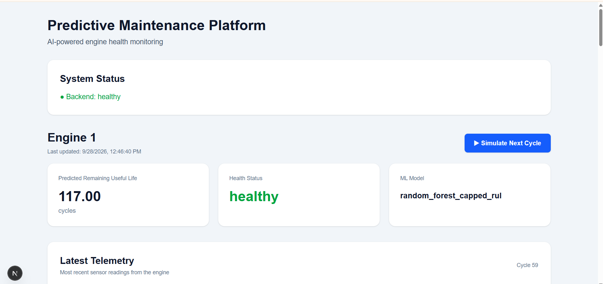
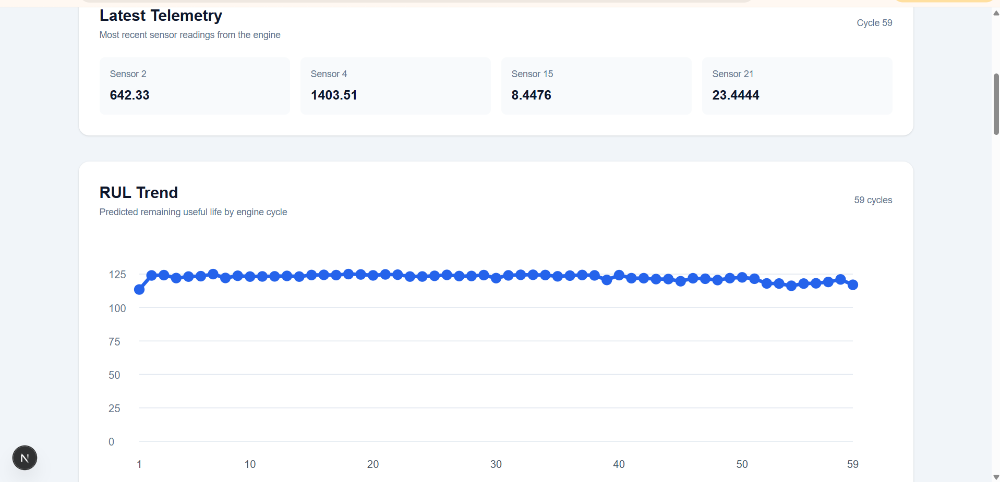
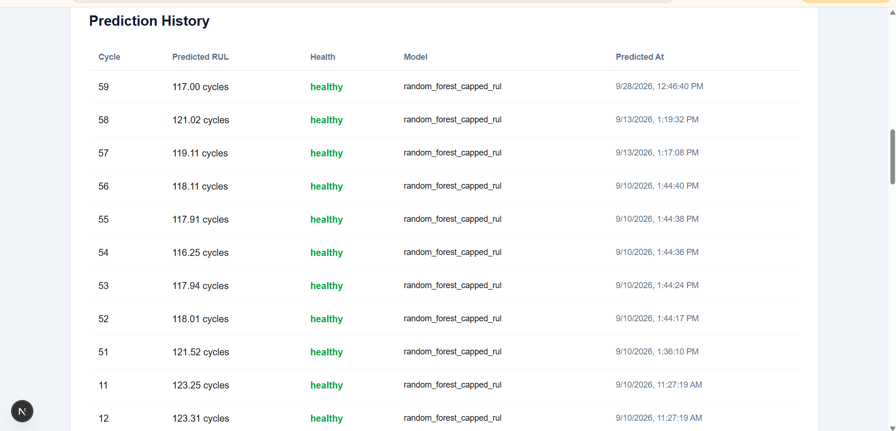
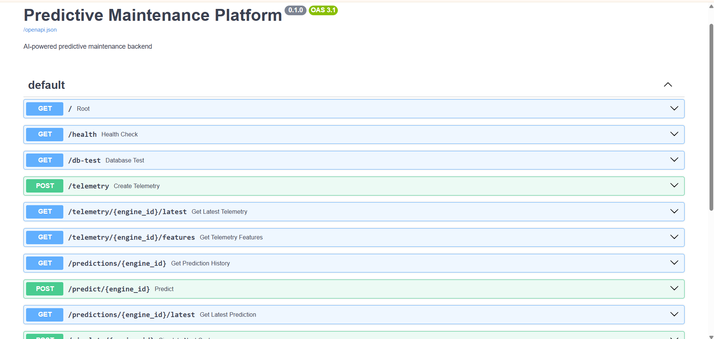

# Predictive Maintenance Platform

An AI-powered full-stack application that monitors aircraft engine health and predicts Remaining Useful Life (RUL) using NASA C-MAPSS FD001 sensor data.

The platform integrates machine learning, telemetry management, a REST API, PostgreSQL, and an interactive dashboard to demonstrate an end-to-end predictive maintenance workflow.

---

## Dashboard Preview

### Main Dashboard



### RUL Trend



### Prediction History



---

## Key Features

- **Telemetry Management:** Stores engine operating settings and sensor readings in PostgreSQL.
- **RUL Prediction:** Uses a Random Forest model to estimate the remaining operating cycles of an engine.
- **Engine Health Classification:** Classifies engine health into Healthy, Warning, and Critical categories based on predicted RUL.
- **Engine-Cycle Simulation:** Simulates the next engine cycle using available telemetry data.
- **Interactive Dashboard:** Displays engine health, predicted RUL, telemetry readings, and prediction trends.
- **Prediction History:** Stores and displays historical predictions.
- **REST API:** Provides endpoints for telemetry management, predictions, and simulation.

---

## System Architecture

```text
       NASA C-MAPSS FD001 Dataset
                    |
                    v
       Data Preprocessing
                    |
                    v
       Feature Engineering
                    |
                    v
          Random Forest Model
                    |
                    v
             FastAPI Backend
                    |
              PostgreSQL
                    |
                    v
          Next.js Dashboard
                    |
                    v
       Engine Health and RUL
             Visualization
```

---

## Technologies Used

| Component | Technology |
|---|---|
| Programming Language | Python |
| Machine Learning | Scikit-learn, Random Forest |
| Backend | FastAPI |
| API Server | Uvicorn |
| Database | PostgreSQL |
| Frontend | Next.js, React, TypeScript |
| Styling | Tailwind CSS |
| Dataset | NASA C-MAPSS FD001 |
| Data Processing | Pandas, NumPy |

---

## Machine Learning

The project uses the NASA C-MAPSS FD001 dataset for engine degradation and Remaining Useful Life prediction.

### Model

- Algorithm: Random Forest Regression
- Target: Remaining Useful Life (RUL)
- RUL values are capped at 125 cycles.
- Engine health is classified using predicted RUL.

### Health Classification

| Health Status | Predicted RUL |
|---|---|
| Healthy | Above 80 cycles |
| Warning | Above 40 and up to 80 cycles |
| Critical | 40 cycles or below |

**Note:** The trained model file is not included in this repository because it exceeds GitHub's regular 100 MB file limit. The model must be generated or obtained separately before running predictions. See the Model Setup section below.

---

## Project Structure

```text
predictive-maintenance-platform/
│
├── assets/
│   ├── dashboard-overview.png
│   ├── rul-trend.png
│   ├── prediction-history.png
│   └── api-documentation.png
│
├── backend/
│   ├── app/
│   │   ├── main.py
│   │   ├── database.py
│   │   ├── models.py
│   │   ├── schemas.py
│   │   ├── predictor.py
│   │   ├── feature_engineering.py
│   │   └── simulation.py
│   │
│   ├── requirements.txt
│   ├── init_db.py
│   ├── load_sample_telemetry.py
│   ├── generate_predictions.py
│   └── test_database.py
│
├── frontend/
│   ├── src/
│   │   ├── app/
│   │   │   └── page.tsx
│   │   └── lib/
│   │       └── api.ts
│   └── package.json
│
├── ml/
│   ├── requirements.txt
│   └── scripts/
│       ├── prepare_data.py
│       ├── feature_engineering.py
│       ├── train_capped_rul.py
│       ├── evaluate_capped_rul.py
│       └── ...
│
├── models/
│   └── (trained model generated or obtained separately)
│
├── .env.example
├── .gitignore
└── README.md
```

---

## Installation and Setup

### Prerequisites

Make sure you have installed:

- Python 3.12
- Node.js and npm
- PostgreSQL
- Git

### 1. Clone the Repository

```bash
git clone https://github.com/SsnehaRao/predictive-maintenance-platform.git
cd predictive-maintenance-platform
```

### 2. Backend Setup

Create a Python virtual environment in the project root:

```cmd
python -m venv .venv
```

Activate it:

```cmd
.venv\Scripts\activate
```

Install backend dependencies:

```cmd
pip install -r backend\requirements.txt
```

Configure the backend environment variables and PostgreSQL connection using the appropriate environment file.

Make sure your PostgreSQL server is running and the required database is configured.

### 3. Database Setup

Initialize the database using the project's database initialization script:

```cmd
cd backend
python -m app.init_db
```

Return to the project root when finished:

```cmd
cd ..
```

### 4. Model Setup

The trained Random Forest model is excluded from this repository because of its file size.

Before running predictions, ensure that the trained model is available at the model path expected by the backend.

The training and data preparation scripts are available in:

```text
ml/scripts/
```

Refer to the training script and model configuration for the required dataset location, output path, and model generation procedure.

The NASA C-MAPSS FD001 dataset must also be obtained and prepared separately.

### 5. Start the Backend

From the project root:

```cmd
cd backend
..\.venv\Scripts\activate
uvicorn app.main:app --reload
```

Backend URL:

http://127.0.0.1:8000

API documentation:

http://127.0.0.1:8000/docs

### 6. Frontend Setup

Open another terminal window:

```cmd
cd frontend
npm install
npm run dev
```

Frontend URL:

http://localhost:3000

---

## API Documentation

The backend exposes REST API endpoints for:

- Health checks
- Database connectivity
- Telemetry creation and retrieval
- Feature retrieval
- RUL prediction
- Prediction history
- Latest predictions
- Engine-cycle simulation

FastAPI provides interactive API documentation through Swagger UI.



Open:

http://127.0.0.1:8000/docs

---

## Application Workflow

1. Engine telemetry is loaded into PostgreSQL.
2. The backend retrieves telemetry for the selected engine.
3. Feature engineering prepares the input features.
4. The Random Forest model predicts the remaining useful life.
5. The backend determines the engine health status.
6. The prediction is stored in PostgreSQL.
7. The frontend retrieves and displays the latest results.
8. The simulation endpoint advances the engine to the next available cycle and generates an updated prediction.

---

## Future Improvements

- Automated backend testing
- Improved error handling and validation
- Automated prediction cleanup and retention
- Docker-based deployment
- Cloud deployment
- User authentication
- Support for multiple engines
- Model monitoring and retraining
- Evaluation of advanced machine learning models

---

## Project Status

**Core Full-Stack MVP Implemented**

The application successfully integrates:

- Engine telemetry data
- Machine learning-based RUL predictions
- PostgreSQL database storage
- FastAPI backend services
- Next.js dashboard visualization
- Engine-cycle simulation
- Prediction history and trend analysis

This project demonstrates an end-to-end implementation of a predictive maintenance application using machine learning and full-stack development technologies.